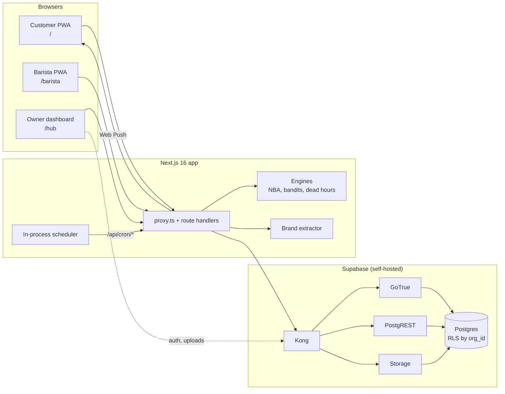

<div align="center">

# Looyaal

**Self-hosted loyalty app and AI marketing engine for independent cafes.**

Turn your website into a branded, installable loyalty app in minutes, then let a learning engine decide who to bring back, when, and with which offer.

[](LICENSE)


[Quick start](#quick-start) · [How it works](#how-it-works) · [Engines](docs/engines.md) · [App builder](docs/app-builder.md) · [Self-hosting](docs/self-hosting.md) · [API](docs/api.md)

</div>

---

Looyaal gives a single cafe (with any number of branches) three things that normally require a chain-sized budget:

1. **A branded customer app** generated from the cafe's own website: colors, logo, typography and layout are extracted and mapped onto a library of 113 interchangeable UI components, delivered as a PWA customers install from the browser. No app store, no per-cafe build.
2. **A counter workflow** that takes one scan: the customer shows a short-lived QR, the barista's phone confirms it, and the stamp, reward or offer is recorded.
3. **An intelligence layer** that learns from real visits: churn scoring, lifecycle and RFM segmentation, a next-best-action engine with Thompson-sampling bandits, dead-hour filling, adaptive discounts, streaks and challenges, all with frequency caps and quiet hours.

Everything runs on your own server with `docker compose up`. One install, one cafe, your data.

## Contents

- [Features](#features)
- [How it works](#how-it-works)
- [The three apps](#the-three-apps)
- [The app builder](#the-app-builder)
- [The intelligence engines](#the-intelligence-engines)
- [Quick start](#quick-start)
- [Configuration](#configuration)
- [Scheduled jobs](#scheduled-jobs)
- [Project structure](#project-structure)
- [Tech stack](#tech-stack)
- [Security model](#security-model)
- [Status and limitations](#status-and-limitations)
- [Contributing](#contributing)
- [License](#license)

## Features

**Loyalty**
- Digital stamp card (10 stamps for a free coffee by default) with overflow carry-over, rewards and redemption history
- Streaks with a one-day grace, milestone bonus stamps and a free favourite item every 30 days
- Weekly personal challenges with bonus stamps and follow-up discounts
- Owner campaigns targeted by RFM segment and branch, scheduled or immediate
- Multi-branch: per-branch QR codes, staff, time zones and metrics

**Customer app (PWA)**
- Generated from the cafe's website by an in-app brand extractor
- 9 UI slots, 113 variants, about 70 design tokens; light and dark follow the phone
- Installable on iOS and Android, per-cafe manifest and maskable icons, Web Push
- Phone-number login, welcome stamp, card, personal offers, campaigns, menu, profile

**Barista app (PWA)**
- One-scan device pairing, camera QR scanner, drink picker that records the real price
- Single-use QR tokens with atomic confirmation; double-scan protection

**Intelligence**
- Churn risk from each customer's own visit cadence
- Next-best-action engine choosing among 9 actions per customer per day
- Beta-Bernoulli Thompson sampling per segment, action and weather context
- Dead-hour detection and targeted, drink-specific offers with per-customer bandits
- Visit-based attribution windows, adaptive per-customer discount, give-up rule
- Frequency caps, quiet hours, cold-start gates and an owner master switch

**Growth (optional integrations)**
- Weather-aware targeting and copy (OpenWeatherMap)
- Google review sync, sentiment, reply drafts and auto-replies (Google Business Profile)
- Local influencer discovery with locality and "free coffee" scoring (Instagram Graph API)
- POS webhooks to attach receipts to visits

## How it works



Every visit is confirmed by a barista, which makes the visit table trustworthy ground truth. The engines decide nightly what each customer should receive, log every decision, and learn from whether the customer actually came back:


Details: [docs/architecture.md](docs/architecture.md). Interactive system map: [docs/architecture.html](docs/architecture.html) (open it in a browser).

## The three apps

| App | Who | Where | What it does |
| --- | --- | --- | --- |
| **Owner dashboard** | cafe owner | `/hub`, `/loyalty`, `/editor`, `/campaigns`, `/reviews`, `/influencers`, `/settings` | Earnings breakdown by source (loyalty, campaigns, win-backs, dead hours, subscriptions), customer list and profiles, campaign performance and activity feed, branches with QR codes and staff, the app editor, campaigns, reviews, influencers, automation settings and discount bounds |
| **Customer app** | your customers | `/` of your domain | Installable PWA in the cafe's brand: stamp card and streak, personal offers ("Sana Özel"), campaigns, challenge, menu, profile and notification settings. Customers sign in with their phone number |
| **Barista app** | staff | `/barista` | Installable PWA paired to the barista's own phone by QR. Scans customer QR codes, shows who and what, records the drink and confirms stamps, rewards, campaigns, offers and subscriptions |

First run: the owner creates the single owner account, then an onboarding wizard builds the app (website URL, brand extraction, color, logo, banner, style, shape, stamp card, photos, font, density, language, layout, location).

## The app builder

```
website URL ─▶ extractor ─▶ draft answers ─▶ wizard ─▶ variant mapper ─▶ pwa_config ─▶ tokens + variants ─▶ app
```

- **Extraction** (`lib/extractor/`): an SSRF-safe fetch of the page and up to 6 stylesheets, static CSS and DOM analysis (weighted colors, theme-color, CSS variables, fonts, radii, shadows, gradients, spacing, logo and banner candidates, language, eight layout patterns), and a weighted linear model that scores the shop style (premium, craft, cozy, modern) with a confidence for every answer.
- **Tokens** (`lib/pwa-tokens.ts`): one brand hex becomes the full palette in HSL, with brand-tinted near-neutral surfaces for dark and light mode; spacing, radii and type are in container-query units against a 390 px reference, so the dashboard preview is pixel-proportional to the phone.
- **Variants** (`components/pwa-v2/variants/`): 113 components across 9 slots (stamp card, header, menu, campaigns, personal offers, challenge, activity, profile, navigation), code-split per slot.
- **Mapping** (`lib/variant-mapper.ts`): pools chosen by the answers and assets, a deterministic hash pick seeded by brand color and style, and an override that mirrors the website's dominant layout.
- **Installability**: per-cafe manifest, logo-derived maskable icons rendered with `sharp`, a service worker with push and click tracking.

Full walkthrough: [docs/app-builder.md](docs/app-builder.md).

## The intelligence engines

| Engine | What it does | Where |
| --- | --- | --- |
| Visit processing | Single write path for confirmed visits: server-side price, local-time bucketing, stamps, attribution, streak, challenge | `lib/visit-processing.ts` |
| Churn risk | Risk from the overdue ratio `daysSince / avgGap` with absolute-day floors and a thin-history override | `app/api/cron/daily-intelligence` |
| Segmentation | Lifecycle segments (new, active, at_risk, dormant, lapsed_new) for decisions; RFM quintiles in SQL for campaigns | `lib/thompson-sampling.ts`, `compute_rfm_segments()` |
| Next best action | Scores 9 actions (streak, near reward, goal gradient, challenge, birthday, re-engagement with a 30/60/90-day win-back cadence, hero offer, welcome, nothing), applies segment multipliers and repeat suppression, picks one | `lib/nba-engine.ts` |
| Thompson sampling | Beta(1,1) priors per segment, action and weather; activates after 100 to 200 observations per segment | `lib/thompson-sampling.ts` |
| Dead hours | Finds weekly slots below half the location's average, targets likely customers with a drink-specific offer before the slot, learns per-customer propensity, abandons slots that never convert | `lib/dead-hour-*.ts` |
| Discounts | Per-customer discount moves 2 points down after a visit and up after a miss, within the owner's bounds; pauses automation for customers gone 90+ days | `lib/intelligence.ts` |
| Delivery | Quiet hours, one push per day, weekly cap with exemptions for the highest-value moments, stale-message expiry | `app/api/cron/notification-queue` |
| Reviews | Keyword-plus-rating sentiment, template reply drafts, optional auto-reply for 3+ stars | `lib/sentiment.ts`, `lib/review-reply-generator.ts` |
| Influencers | 70/30 exploit-explore hashtag budget, locality, accessibility and impact scores | `lib/discovery-engine.ts`, `lib/instagram.ts` |

Every formula, threshold and update rule is documented in [docs/engines.md](docs/engines.md).

## Quick start

Requirements: Docker with Compose v2, and Node.js 22 to generate secrets.

```bash
git clone <this repository> looyaal && cd looyaal
npm ci                                   # the secret generator needs web-push
cp .env.example .env
node scripts/generate-secrets.mjs        # fills every empty secret in .env
docker compose up -d                     # Supabase + app; migrations apply automatically
```

Open `NEXT_PUBLIC_APP_URL` (default `http://localhost:3000`), create the owner account and follow the onboarding wizard.

Looyaal runs anywhere Docker runs. For real use it must be reachable over **HTTPS**: browsers only allow PWA installation, service workers and push notifications on secure origins. Put any TLS-terminating reverse proxy in front of the app port and the Supabase gateway port, set the two public URLs in `.env`, and rebuild. See [docs/self-hosting.md](docs/self-hosting.md) for production, backups, upgrades and integrations.

## Configuration

All variables are documented in [`.env.example`](.env.example). `NEXT_PUBLIC_*` values are compiled into the browser bundle: rebuild with `docker compose up -d --build app` after changing them.

| Variable | Required | Description |
| --- | --- | --- |
| `NEXT_PUBLIC_APP_URL` | yes | Public URL of the app (customers, staff, OAuth redirects) |
| `NEXT_PUBLIC_SUPABASE_URL` | yes | Public URL of the Supabase gateway (Kong) |
| `APP_PORT`, `KONG_HTTP_PORT` | no | Host ports (default 3000 and 8000) |
| `POSTGRES_PASSWORD` | yes | Database password (generated; do not change after first start) |
| `JWT_SECRET` | yes | Supabase JWT signing secret (generated) |
| `NEXT_PUBLIC_SUPABASE_ANON_KEY` | yes | Public anon key (generated) |
| `SUPABASE_SERVICE_ROLE_KEY` | yes | Service-role key, server only (generated) |
| `JWT_EXPIRY` | no | Access token lifetime in seconds (3600) |
| `SUPABASE_SERVER_URL` | no | Internal Supabase URL for server calls (compose sets `http://kong:8000`) |
| `DISABLE_SIGNUP` | no | Set `true` after the owner account exists |
| `ENABLE_EMAIL_AUTOCONFIRM` | no | `true` skips email confirmation; set `false` once SMTP works |
| `ADDITIONAL_REDIRECT_URLS` | no | Extra auth redirect URLs |
| `SMTP_ADMIN_EMAIL`, `SMTP_HOST`, `SMTP_PORT`, `SMTP_USER`, `SMTP_PASS`, `SMTP_SENDER_NAME` | no | Email for confirmations and password resets |
| `CRON_SECRET` | yes | Bearer token for `/api/cron/*` (generated) |
| `QR_TOKEN_SECRET` | yes | Customer QR tokens (generated) |
| `BARISTA_SETUP_SECRET` | yes | Barista pairing tokens (generated) |
| `CUSTOMER_SESSION_SECRET` | yes | Customer session cookie signature (generated) |
| `POS_WEBHOOK_SECRET` | yes | Shared secret for POS webhooks (generated) |
| `NEXT_PUBLIC_VAPID_PUBLIC_KEY`, `VAPID_PRIVATE_KEY` | yes | Web Push key pair (generated) |
| `VAPID_SUBJECT` | no | Push contact, for example `mailto:you@yourcafe.com` |
| `TZ` | recommended | Cafe time zone for send hours and quiet hours, for example `Europe/Lisbon` |
| `LOOYAAL_SCHEDULER` | no | `on` (default) runs jobs in-process; `off` to use an external cron |
| `LOOYAAL_SCHEDULER_URL` | no | Base URL the scheduler calls (default `http://127.0.0.1:$PORT`) |
| `OPENWEATHERMAP_API_KEY` | no | Enables weather-aware targeting |
| `GOOGLE_CLIENT_ID`, `GOOGLE_CLIENT_SECRET` | no | Enables Google review sync and replies |
| `META_APP_ID`, `META_APP_SECRET` | no | Enables Instagram influencer discovery |
| `DASHBOARD_USERNAME`, `DASHBOARD_PASSWORD`, `PG_META_CRYPTO_KEY` | no | Supabase Studio (`--profile studio`) |
| `ENABLE_IMAGE_TRANSFORMATION` | no | Image resizing via imgproxy (`--profile imgproxy`) |

Optional integrations switch themselves off when their keys are empty.

## Scheduled jobs

The scheduler in `instrumentation.ts` / `lib/scheduler/` runs these jobs **in UTC** by calling `POST /api/cron/<job>` with the cron secret. With `LOOYAAL_SCHEDULER=off`, call the same endpoints from any cron.

| Job | Schedule (UTC) | What it does |
| --- | --- | --- |
| `cleanup-influencers` | daily 03:00 | Deletes stale or rejected discoveries and data of disconnected accounts |
| `weekly-rfm` | Mon 04:00 | Recomputes RFM scores and segments in SQL |
| `weekly-model-update` | Mon 04:30 | Shop intelligence: effective discount, click rate, weather sensitivity |
| `daily-intelligence` | daily 05:00 | Churn, preferences, dead hours, NBA decisions, dead-hour targeting, challenges, learning |
| `weekly-measurement` | daily 06:00 | Incremental lift and ROI over the last 7 days (needs a holdback group) |
| `discover-influencers` | daily 06:00 | Hashtag-driven local influencer discovery |
| `birthday-check` | daily 07:00 | Birthday push and same-day free-item offer |
| `sync-reviews` | 07:00, 13:00, 19:00 | Google review import, sentiment, reply drafts |
| `hourly-weather` | hourly 08:00-21:00 | Weather per location city |
| `dead-hour-trigger` | hourly 08:00-21:00 | No-op kept for compatibility |
| `notification-queue` | every 15 min, 09:00-21:45 | Delivers due pushes within quiet hours and caps |
| `campaign-scheduler` | every 15 min, 09:00-21:45 | Starts scheduled owner campaigns |

```mermaid
gantt
    title A day of jobs (UTC)
    dateFormat HH:mm
    axisFormat %H:%M
    section Nightly
    cleanup-influencers      :03:00, 10m
    weekly-rfm (Mon)         :04:00, 10m
    weekly-model-update (Mon):04:30, 10m
    daily-intelligence       :crit, 05:00, 30m
    weekly-measurement       :06:00, 10m
    discover-influencers     :06:00, 20m
    section Morning
    birthday-check           :07:00, 10m
    sync-reviews             :07:00, 10m
    section Daytime
    hourly-weather           :08:00, 780m
    notification-queue (15m) :active, 09:00, 765m
    campaign-scheduler (15m) :09:00, 765m
    sync-reviews             :13:00, 10m
    sync-reviews             :19:00, 10m
```



Push send hours and quiet hours use the server's local time, so set `TZ` and align the daytime windows to your opening hours (see [docs/self-hosting.md](docs/self-hosting.md#time-zone)).

## Project structure

```
app/
  (public)/[orgSlug]/        customer PWA, served at / by proxy.ts
  (dashboard)/               owner dashboard (hub, loyalty, editor, campaigns, ...)
  barista/                   barista PWA (login, setup, scanner)
  onboarding/                app-builder wizard
  api/                       route handlers: public, barista, cron, webhooks, setup, ...
components/
  pwa-v2/                    token provider, shell, tabs, variant registry
  pwa-v2/variants/           113 UI variants
  pwa/, barista/, dashboard/, onboarding/, ui/
lib/
  nba-engine.ts              next-best-action (pure function)
  thompson-sampling.ts       bandit sampling, segments, activation
  dead-hour-targeting.ts     dead-hour targeting
  dead-hour-learning.ts      dead-hour learning and abandonment
  intelligence.ts            preferences, copy, discount learning, shop stats
  visit-processing.ts        confirmed-visit write path
  attribution.ts, streaks.ts, challenges.ts, targeting.ts, weather.ts
  sentiment.ts, review-reply-generator.ts, discovery-engine.ts, instagram.ts
  pwa-tokens.ts, variant-mapper.ts, color-utils.ts, variant-schematics/
  extractor/                 brand extractor
  scheduler/                 in-process cron
  supabase/                  browser, server and admin clients
supabase/migrations/         schema, RLS, SQL functions, storage buckets
docker/                      Kong, database roles, migration runner
scripts/                     generate-secrets.mjs, icon generation, checks
docs/                        architecture, engines, app builder, self-hosting, API
instrumentation.ts           starts the scheduler
proxy.ts                     routing and auth gate
docker-compose.yml           full stack
```

## Tech stack

| Layer | Technology |
| --- | --- |
| App | Next.js 16 (App Router, standalone output), React 19, TypeScript (strict) |
| UI | Tailwind CSS 4, Motion, Lucide icons, Recharts |
| Validation | Zod |
| Data | Supabase: Postgres 15, GoTrue, PostgREST, Storage, Kong; `@supabase/ssr` |
| PWA | Web App Manifest, service worker, Web Push (`web-push`, VAPID) |
| Counter | `html5-qrcode` scanner, `qrcode` / `qrcode.react` |
| Extraction and images | `cheerio`, `sharp`, `browser-image-compression` |
| Runtime | Node.js 22, Docker Compose |

## Security model

- **Owner and baristas** use Supabase Auth. The owner account can be created exactly once; baristas are created by the owner and pair their phone with a single-use, 24-hour setup token.
- **Customers sign in with their phone number only.** This is a deliberate trade-off for speed: someone who types another person's number can see that person's card. Nothing of value moves without a barista confirming a single-use, 2-minute QR token at the counter. Read [SECURITY.md](SECURITY.md) before deploying.
- **Data isolation**: every table carries `org_id` with row-level security via `get_user_org_id()`; the service-role key stays on the server; token tables are service-role only.
- **Outbound fetches** from the brand extractor are restricted to public IP addresses with size and time limits.

Report vulnerabilities privately as described in [SECURITY.md](SECURITY.md).

## Status and limitations

Looyaal is young open-source software extracted from a production system. Things to know:

- Customer-facing copy, sentiment word lists and some defaults (phone format `+90`, `Europe/Istanbul` time zone, weather country code, currency) currently assume Turkey; the `language` setting is stored but the UI is not translated yet.
- The engines are heuristic plus online Bayesian learning, tuned for small cafes; there is no offline-trained model.
- Known engine issues are listed in [docs/engines.md](docs/engines.md#21-known-limitations).

Internationalisation, a holdback-based measurement group and an optional customer verification step are good first areas to contribute.

## Contributing

Contributions are welcome. Read [CONTRIBUTING.md](CONTRIBUTING.md) for the development setup, code conventions (no file over 500 lines, Zod for every input, server-only service key) and the pull-request checklist, and follow the [Code of Conduct](CODE_OF_CONDUCT.md).

## License

[MIT](LICENSE) © 2026 Looyaal contributors.
