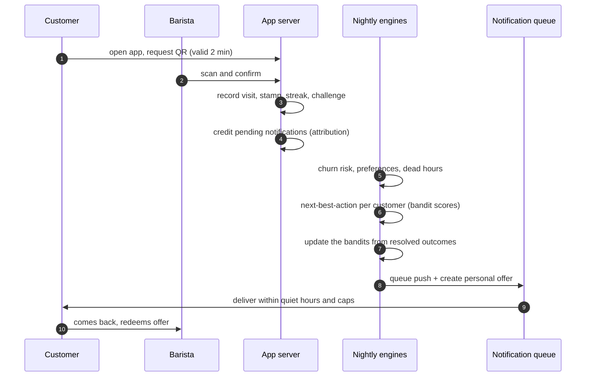

<div align="center">

# Looyaal

**Self-hosted loyalty app and AI marketing engine for independent cafes.**

Turn your website into a branded, installable loyalty app in minutes, then let a learning engine decide who to bring back, when, and with which offer.

[](LICENSE)


[Quick start](#quick-start) · [Self-hosting](docs/self-hosting.md) · [Architecture](docs/architecture.md) · [Engines](docs/engines.md) · [App builder](docs/app-builder.md) · [API](docs/api.md)

</div>

---

Looyaal gives a single cafe (with any number of branches) three things that normally require a chain-sized budget:

1. **A branded customer app** generated from the cafe's own website. Colors, logo, typography and layout are extracted and mapped onto a library of 113 UI components, delivered as an app customers install straight from the browser. No app store, no per-cafe build.
2. **A one-scan counter workflow.** The customer shows a short-lived QR code, the barista's phone confirms it, and the stamp, reward or offer is recorded.
3. **An intelligence layer that learns from real visits.** It predicts who is drifting away, picks the best message for each customer every day, fills quiet hours with targeted offers, and learns from who actually comes back.

Everything runs on your own server with `docker compose up`. One install, one cafe, your data.

## Features

- **Loyalty:** digital stamp card and rewards, streaks, weekly personal challenges, birthday treats, owner campaigns by customer segment and branch.
- **Customer app:** generated from the cafe's website, installable on iOS and Android, push notifications, phone-number login, personal offers, menu and profile.
- **Barista app:** pairs to a staff phone with one scan, camera QR scanner, single-use tokens with double-scan protection.
- **Owner dashboard:** earnings by source, customers, campaigns, branches with QR codes and staff, a live app editor, automation settings.
- **Intelligence:** churn risk from each customer's own visit rhythm, a next-best-action engine with Thompson-sampling bandits, dead-hour filling, adaptive discounts, frequency caps and quiet hours.
- **Optional integrations:** weather-aware messages, Google review sync with reply drafts, local influencer discovery, POS webhooks. Each one switches off when its keys are empty.

## How it works

Every visit is confirmed by a barista, which makes the visit history trustworthy. Each night the engines decide what each customer should receive, log the decision, and learn from whether the customer came back:



Under the hood it is one Next.js app on top of a self-hosted Supabase stack (Postgres, auth, REST, storage), with jobs scheduled inside the app. The [architecture guide](docs/architecture.md) covers routing, the data model and every core flow; [docs/architecture.html](docs/architecture.html) is an interactive map of the whole system (open it in a browser). The [engines guide](docs/engines.md) documents every formula, threshold and learning rule, and the [app builder guide](docs/app-builder.md) explains how a website becomes a branded app.

## Quick start

Requirements: Docker with Compose v2, and Node.js 22 to generate secrets.

```bash
git clone https://github.com/ArynBuilds/Looyaal.git looyaal && cd looyaal
npm ci                                   # the secret generator needs web-push
cp .env.example .env
node scripts/generate-secrets.mjs        # fills every empty secret in .env
docker compose up -d                     # Supabase + app; migrations apply automatically
```

Open `http://localhost:3000`, create the owner account and follow the setup wizard.

For real use the app must be reachable over **HTTPS**, because browsers only allow app installation and push notifications on secure sites. Looyaal runs anywhere Docker runs; put any TLS reverse proxy in front of it. The [self-hosting guide](docs/self-hosting.md) covers configuration, the job schedule, time zones, integrations, backups and upgrades.

## Security

- The owner account can be created exactly once; baristas are added by the owner and pair their phone with a single-use setup code.
- **Customers sign in with their phone number only.** This is a deliberate trade-off for speed: someone who types another person's number can see that person's card. Nothing of value moves without a barista confirming a single-use, 2-minute QR code at the counter.
- Every table is isolated by organization with Postgres row-level security, and the service key never leaves the server.

Read [SECURITY.md](SECURITY.md) before deploying, and report vulnerabilities privately as described there.

## Status

Looyaal is young open-source software extracted from a production system.

- Copy and some defaults (phone format `+90`, `Europe/Istanbul` time zone, currency) currently assume Turkey; the UI is not translated yet.
- The engines are heuristics plus online Bayesian learning, tuned for small cafes; there is no offline-trained model.
- Known issues are listed in [docs/engines.md](docs/engines.md#21-known-limitations).

Internationalisation, a holdback-based measurement group and an optional customer verification step are good first areas to contribute.

## Contributing

Contributions are welcome. [CONTRIBUTING.md](CONTRIBUTING.md) covers the development setup, code conventions and the pull-request checklist. Please follow the [Code of Conduct](CODE_OF_CONDUCT.md).

## License

[MIT](LICENSE) © 2026 Looyaal contributors.
