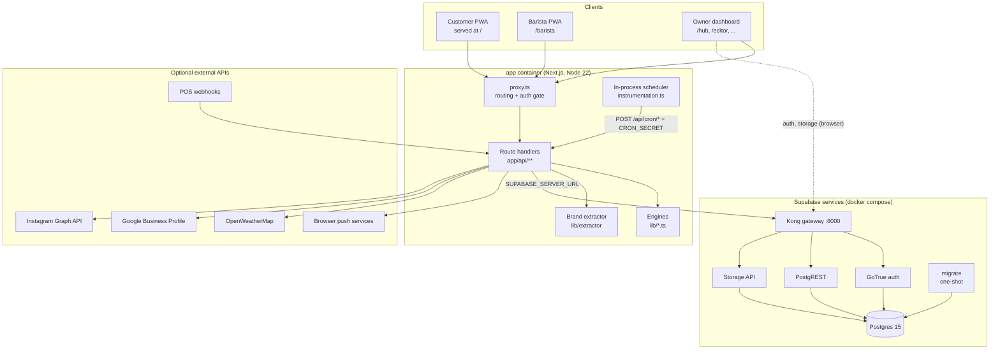
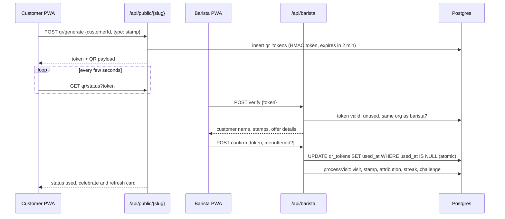

# Architecture

Looyaal is one Next.js 16 application (App Router, TypeScript, React 19) in front of a self-hosted Supabase stack (Postgres, GoTrue, PostgREST, Storage behind a Kong gateway). One install serves exactly one cafe, which may have several branches.

- [1. System overview](#1-system-overview)
- [2. The Next.js application](#2-the-nextjs-application)
- [3. Supabase services](#3-supabase-services)
- [4. Request routing and authentication](#4-request-routing-and-authentication)
- [5. Data access: two clients](#5-data-access-two-clients)
- [6. Data model](#6-data-model)
- [7. Tenancy and row-level security](#7-tenancy-and-row-level-security)
- [8. Storage](#8-storage)
- [9. Core flows](#9-core-flows)
- [10. Background work](#10-background-work)
- [11. External integrations](#11-external-integrations)
- [12. Source layout](#12-source-layout)
- [13. Tech stack](#13-tech-stack)

---

## 1. System overview



- The browser talks to the Next.js app for everything customer-facing and to Kong (`NEXT_PUBLIC_SUPABASE_URL`) for owner and barista authentication and uploads.
- Server code talks to Kong over the internal Docker network (`SUPABASE_SERVER_URL=http://kong:8000`, see section 5).
- The database is never exposed directly; Kong is the only public Supabase entry point.

---

## 2. The Next.js application

| Surface | Routes | Audience | Auth |
| --- | --- | --- | --- |
| Customer PWA | `/` (rewritten to the cafe's internal `/{slug}` page) | customers | phone number, signed session cookie |
| Barista PWA | `/barista/login`, `/barista/setup`, `/barista/{slug}` | staff | Supabase Auth (email + password, paired by QR) |
| Owner dashboard | `/hub`, `/loyalty`, `/editor`, `/campaigns/*`, `/customers/*`, `/influencers`, `/reviews`, `/locations`, `/settings` | owner | Supabase Auth (email + password) |
| Setup and onboarding | `/onboarding`, `/login`, `/forgot-password`, `/reset-password` | owner | first-run setup, then Supabase Auth |
| Customer API | `/api/public/{slug}/*` | PWA | customer identity (see `SECURITY.md`) |
| Owner and staff API | `/api/org`, `/api/locations`, `/api/staff/*`, `/api/campaigns/*`, `/api/reviews/*`, `/api/influencers/*`, `/api/barista/*`, ... | dashboard, barista app | Supabase session cookie |
| Jobs | `/api/cron/*` | scheduler or external cron | `Authorization: Bearer $CRON_SECRET` |
| Webhooks | `/api/webhooks/pos/*` | POS systems | `x-webhook-secret: $POS_WEBHOOK_SECRET` |

The full endpoint list is in `docs/api.md`.

---

## 3. Supabase services

`docker-compose.yml` runs a minimal Supabase subset:

| Service | Image | Role |
| --- | --- | --- |
| `db` | `supabase/postgres` 15.8 | Postgres with Supabase roles, `pgcrypto`, `uuid-ossp` |
| `auth` | `supabase/gotrue` | Email + password auth for owner and baristas; phone auth disabled |
| `rest` | `postgrest/postgrest` | REST over the `public` and `storage` schemas, JWT-authenticated, RLS enforced |
| `storage` | `supabase/storage-api` | File backend on the `storage-data` volume |
| `kong` | `kong/kong` | API gateway: `/auth/v1`, `/rest/v1`, `/storage/v1`, key-auth with the anon / service keys |
| `migrate` | `supabase/postgres` | One-shot job: applies `supabase/migrations/*.sql` once each, tracked in `supabase_migrations.schema_migrations`, then `NOTIFY pgrst, 'reload schema'` |
| `studio`, `meta` | optional profile `studio` | Supabase Studio behind basic auth |
| `imgproxy` | optional profile `imgproxy` | On-the-fly image transformation |

The app container starts only after `migrate` has completed successfully and Kong is healthy.

---

## 4. Request routing and authentication

`proxy.ts` (the Next.js 16 request proxy, formerly "middleware") does three things:

1. **Root URL.** `/` is rewritten to the cafe's customer app. It reads the install state (`lib/install.ts`): with no organization yet it redirects to the first-run setup, before onboarding is finished it redirects to `/login`, afterwards it rewrites to `/{slug}` (the slug is cached for the process lifetime).
2. **Session refresh.** For dashboard and barista routes it creates a Supabase SSR client on the request cookies, which refreshes the owner or barista access token.
3. **Gate.** Unauthenticated requests to dashboard routes go to `/login`, to barista routes to `/barista/login`.

API routes perform their own authorization (owner role checks, barista org membership, cron secret, webhook secret).

**First run.** `GET /api/setup` reports whether an owner exists. `POST /api/setup` creates the owner through the GoTrue admin API and is refused once an organization exists; the database enforces a single organization per install. The `handle_new_user` trigger on `auth.users` creates the organization, the owner's `users` row, the default 10-stamp loyalty program and a default free-coffee reward.

---

## 5. Data access: two clients

| Client | File | Key | RLS | Used by |
| --- | --- | --- | --- | --- |
| Browser | `lib/supabase/client.ts` | anon key + user JWT | enforced | dashboard pages (reads, settings, uploads) |
| Server (SSR) | `lib/supabase/server.ts` | anon key + user JWT from cookies | enforced | route handlers that act as the signed-in user, `auth.getUser()` |
| Admin | `lib/supabase/admin.ts` | service role | bypassed | route handlers after their own authorization, jobs, webhooks, customer API |

The service-role key never leaves the server. Customer-facing routes use the admin client and scope every query by the organization resolved from the slug and by the customer.

**URL rewrite.** Cookies set by `@supabase/ssr` are named after the Supabase URL, so server clients must be created with the public URL. `lib/supabase/url.ts` therefore keeps the public URL for client construction but installs a custom `fetch` that rewrites it to `SUPABASE_SERVER_URL` (the internal `http://kong:8000`), so server-side calls never leave the Docker network.

---

## 6. Data model

All tables live in `public`. Every business table carries `org_id`. The main entities:

```mermaid
erDiagram
    organizations ||--o{ locations : has
    organizations ||--o{ users : "owner, baristas"
    organizations ||--|| loyalty_programs : runs
    loyalty_programs ||--o{ rewards : offers
    organizations ||--o{ customers : has
    customers ||--|| loyalty_cards : holds
    customers ||--o{ visits : makes
    locations ||--o{ visits : at
    customers ||--o{ redemptions : claims
    customers ||--o{ customer_offers : receives
    customers ||--o{ customer_challenges : takes
    customers ||--o{ notification_queue : "is sent"
    customers ||--o{ notification_audit : "decisions about"
    organizations ||--o{ action_scores : "bandit arms"
    customers ||--|| dead_hour_propensity : "dead-hour posterior"
    locations ||--o{ dead_hour_suggestions : "quiet slots"
    locations ||--o{ weather_data : readings
    organizations ||--o{ campaigns : runs
    campaigns ||--o{ campaign_sends : log
    campaigns ||--o{ campaign_redemptions : redeemed
    customers ||--o{ qr_tokens : shows
    locations ||--o{ reviews : receives
    organizations ||--o{ influencers : discovers
```



| Group | Tables | Notes |
| --- | --- | --- |
| Cafe | `organizations`, `locations`, `users`, `menu_items` | `organizations.pwa_config` (JSONB) is the app design; `locations.timezone` drives all local-time logic; `users.role` is `owner`, `manager` or `barista`, `assigned_locations` pins a barista to a branch |
| Loyalty | `loyalty_programs`, `loyalty_cards`, `rewards`, `redemptions` | One program per org (`UNIQUE(org_id)`), one card per customer (`UNIQUE(org_id, customer_id)`) |
| Customers | `customers`, `visits` | `UNIQUE(org_id, phone)`; derived columns: `churn_risk`, `rfm_segment`, `rfm_score`, `top_items`, `preferred_visit_hour/day`, `avg_spend`, `optimal_discount`, streak fields, `automation_status`; visits store local `day_of_week` and `hour_of_day` |
| Engagement | `customer_offers`, `customer_challenges`, `customer_subscriptions`, `subscription_plans`, `subscription_redemptions` | Offers are the single source of redeemable personalised deals |
| Intelligence | `notification_audit`, `action_scores`, `dead_hour_suggestions`, `dead_hour_propensity`, `shop_intelligence`, `weather_data`, `auto_campaign_settings` | See `docs/engines.md` |
| Messaging | `notification_queue`, `campaigns`, `campaign_sends`, `campaign_redemptions` | `UNIQUE(campaign_id, customer_id)` on redemptions |
| Counter | `qr_tokens`, `barista_setup_tokens`, `active_sessions` | Short-lived tokens; service-role access only |
| Growth | `reviews`, `influencers`, `influencer_campaigns` | Optional integrations |

Database-level guards include CHECK constraints keeping `optimal_discount`, `default_offer_value` and `notification_queue.offer_value` within 0-100.

Schema source of truth: `supabase/migrations/`. Generated TypeScript types: `types/database.ts`.

---

## 7. Tenancy and row-level security

Although an install hosts one cafe, the schema keeps the multi-tenant shape: every table has `org_id`, RLS is enabled, and policies follow one pattern:

```sql
CREATE FUNCTION public.get_user_org_id() RETURNS uuid
  LANGUAGE plpgsql STABLE SECURITY DEFINER AS $$
BEGIN
  RETURN (SELECT org_id FROM public.users WHERE id = auth.uid());
END $$;

CREATE POLICY "Users can only access their org data" ON customers
  FOR ALL USING (org_id = get_user_org_id())
  WITH CHECK (org_id = get_user_org_id());
```

An authenticated owner or barista can therefore only read and write rows of their own organization through PostgREST. Tables that hold secrets or tokens (`qr_tokens`, `active_sessions`, `weather_data`, `barista_setup_tokens`) have RLS enabled with no policies, which denies everyone except the service role. Customers never hold a Supabase JWT; their requests are served by route handlers (see `SECURITY.md`).

---

## 8. Storage

`supabase/migrations/20260415000001_image_upload_buckets.sql` creates two public-read buckets:

| Bucket | Path convention | Write policy |
| --- | --- | --- |
| `org-assets` | `<org_id>/logo.webp`, `<org_id>/banner.webp` (extracted logos under `extracted/`) | authenticated, first path segment must equal `get_user_org_id()` |
| `menu-items` | `<org_id>/<menu_item_id>.webp` | same |

Uploads from the dashboard go through `/api/storage/upload`, which compresses on the client (`browser-image-compression`) and writes with the service role after checking ownership.

---

## 9. Core flows

### 9.1 Earning a stamp



The atomic compare-and-set on `used_at` guarantees that two baristas (or two tabs) confirming the same QR produce one visit.

### 9.2 Redeeming

| What | Customer action | Barista confirm does |
| --- | --- | --- |
| Full card | `reward/claim` creates a pending redemption (2 min) and a `reward` QR | marks redeemed, subtracts `stamps_required` (overflow carries over), increments `cards_completed`, records the visit and its stamp |
| Personal offer | `offer/claim` atomically flips the offer to `claimed` and returns an `offer` QR | records the visit (double stamp for goal-gradient offers), marks the offer `redeemed` (30 min grace past expiry) |
| Campaign | `campaign` QR | inserts `campaign_redemptions` (unique per customer and campaign), records the visit |
| Drink subscription | `subscription` QR | inserts `subscription_redemptions` (daily limit per plan), records a visit without a stamp |

A claimed offer that is never scanned returns to `active` after 5 minutes (nightly housekeeping).

### 9.3 POS matching

`/api/webhooks/pos/{adisyo,simpra}` receive completed orders. The location is found by its POS API key; the transaction is attached to an unmatched QR visit at that location within the last 5 minutes (amount, items, payment method), and any pending reward of that customer is auto-redeemed. Without a matching visit, `lib/pos-matching.ts` falls back to the most recent active PWA session at that location.

---

## 10. Background work

Jobs are ordinary route handlers under `app/api/cron/`. `instrumentation.ts` starts an in-process scheduler (`lib/scheduler/`) when the Node.js server boots: it aligns to the minute, matches each job's 5-field cron expression **in UTC**, and calls `POST /api/cron/<job>` on the same server with the cron secret, never running two instances of the same job concurrently (15-minute timeout per run). Set `LOOYAAL_SCHEDULER=off` to drive the same endpoints from an external cron instead.

The schedule and what each job does are listed in [self-hosting](self-hosting.md#scheduled-jobs) and explained in [engines](engines.md).

---

## 11. External integrations

All integrations are optional and switch off cleanly when their keys are missing.

| Integration | Keys | Used for |
| --- | --- | --- |
| Web Push | `NEXT_PUBLIC_VAPID_PUBLIC_KEY`, `VAPID_PRIVATE_KEY`, `VAPID_SUBJECT` | customer notifications (generated by `scripts/generate-secrets.mjs`) |
| OpenWeatherMap | `OPENWEATHERMAP_API_KEY` | weather-aware targeting and copy |
| Google Business Profile | `GOOGLE_CLIENT_ID`, `GOOGLE_CLIENT_SECRET` | review sync, sentiment, reply drafts and auto-replies; OAuth per location, redirect `NEXT_PUBLIC_APP_URL/api/google/callback` |
| Instagram (Meta Graph API) | `META_APP_ID`, `META_APP_SECRET` | local influencer discovery; OAuth redirect `NEXT_PUBLIC_APP_URL/instagram-callback` |
| POS | `POS_WEBHOOK_SECRET` | attaching receipts to visits |

---

## 12. Source layout

```
app/
  (public)/[orgSlug]/      customer PWA (served at / via proxy.ts)
  (dashboard)/             owner dashboard: hub, loyalty, editor, campaigns, ...
  barista/                 barista PWA: login, setup, scanner
  onboarding/              app-builder wizard
  api/
    public/[orgSlug]/      customer API
    barista/               verify, confirm, setup, manifest
    cron/                  scheduled jobs
    webhooks/pos/          POS receivers
    brand/extract/         brand extractor endpoint
    setup/                 first-run owner creation
components/
  pwa-v2/                  token provider, shell, tabs, variant registry
  pwa-v2/variants/         113 interchangeable UI variants
  pwa/                     customer onboarding and install screens
  barista/, dashboard/, onboarding/, ui/
lib/
  nba-engine.ts            next-best-action scoring (pure)
  thompson-sampling.ts     Beta sampling, segments, activation thresholds
  intelligence.ts          preferences, copy, discount learning, shop stats
  dead-hour-*.ts           dead-hour targeting and learning
  attribution.ts, streaks.ts, challenges.ts, visit-processing.ts
  targeting.ts, weather.ts, sentiment.ts, review-reply-generator.ts
  discovery-engine.ts, instagram.ts, google-business.ts
  pwa-tokens.ts, variant-mapper.ts, color-utils.ts, variant-schematics/
  extractor/               SSRF-safe fetch, CSS and DOM signals, style scoring
  scheduler/               cron parser, job table, in-process runner
  supabase/                browser, server and admin clients
  customer-session.ts, barista-setup-token.ts, push.ts, install.ts
supabase/migrations/       schema, RLS, functions, storage buckets
docker/                    Kong config, DB roles, migration runner
scripts/                   generate-secrets.mjs, icon generation, checks
public/sw.js               service worker
instrumentation.ts         starts the scheduler
proxy.ts                   routing and auth gate
```

---

## 13. Tech stack

| Layer | Technology |
| --- | --- |
| App | Next.js 16 (App Router, standalone output), React 19, TypeScript (strict) |
| UI | Tailwind CSS 4, Motion, Lucide icons, Recharts |
| Validation | Zod |
| Data | Supabase: Postgres 15, GoTrue, PostgREST, Storage, Kong; `@supabase/ssr` |
| PWA | Web App Manifest, service worker, Web Push (`web-push`, VAPID) |
| Counter | `html5-qrcode` scanner, `qrcode` / `qrcode.react` |
| Extraction and images | `cheerio`, `sharp`, `browser-image-compression` |
| Runtime | Node.js 22, Docker Compose |
