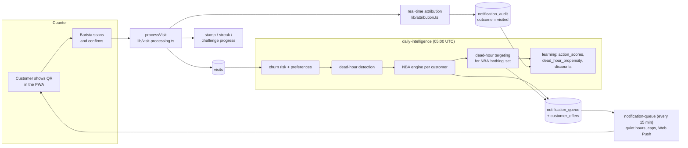
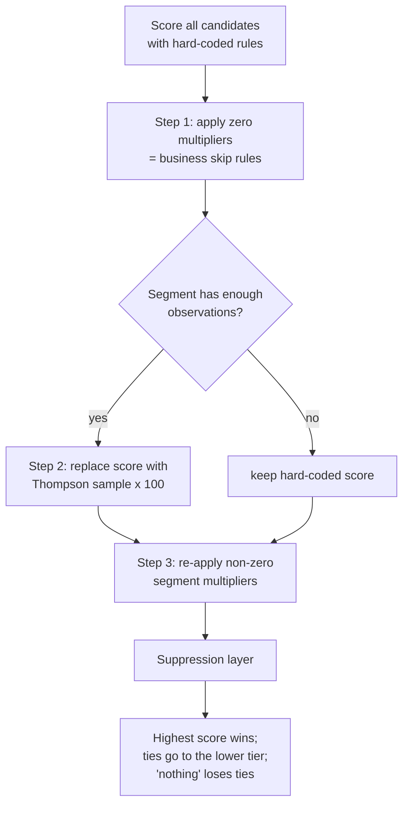

# Intelligence engines

This document explains, at the level of formulas and thresholds, how Looyaal decides **who** to contact, **when**, with **what**, and how it learns from the result. Every number below is taken from the source; file paths are given so you can verify and tune them.

All engines are plain TypeScript running inside the Next.js server. There is no separate ML service, no model file and no GPU. The "learning" is online Bayesian updating (Beta-Bernoulli bandits) plus a set of deterministic heuristics that are deliberately simple enough for a single cafe with a few hundred customers.

- [1. The closed loop](#1-the-closed-loop)
- [2. Visit processing](#2-visit-processing)
- [3. Customer profiling](#3-customer-profiling)
- [4. Churn risk scoring](#4-churn-risk-scoring)
- [5. Segmentation](#5-segmentation)
- [6. Next-best-action engine](#6-next-best-action-engine)
- [7. Thompson sampling bandit](#7-thompson-sampling-bandit)
- [8. Daily orchestration and safety gates](#8-daily-orchestration-and-safety-gates)
- [9. Adaptive discount learning](#9-adaptive-discount-learning)
- [10. Dead-hour engine](#10-dead-hour-engine)
- [11. Streaks](#11-streaks)
- [12. Challenges](#12-challenges)
- [13. Attribution](#13-attribution)
- [14. Notification delivery](#14-notification-delivery)
- [15. Weather context](#15-weather-context)
- [16. Measurement and reporting](#16-measurement-and-reporting)
- [17. Reviews: sentiment and reply drafts](#17-reviews-sentiment-and-reply-drafts)
- [18. Influencer discovery](#18-influencer-discovery)
- [19. Message generation](#19-message-generation)
- [20. Tuning reference](#20-tuning-reference)
- [21. Known limitations](#21-known-limitations)

---

## 1. The closed loop



1. A visit is only ever created by a barista confirming a short-lived QR token (or by a matched POS transaction). This is the ground truth everything else learns from.
2. Every night, `app/api/cron/daily-intelligence/route.ts` rescores churn, rebuilds preferences and dead hours, then runs the next-best-action (NBA) engine once per customer.
3. Every decision, including "do nothing", is written to `notification_audit` together with the customer's state at decision time and an attribution window.
4. When the customer visits within the window, the audit row flips to `visited`. When the window passes, it flips to `no_visit`.
5. Resolved audits update the bandit posteriors (`action_scores`, `dead_hour_propensity`) and the per-customer discount (`customers.optimal_discount`). Tomorrow's decisions use the updated posteriors.

---

## 2. Visit processing

`lib/visit-processing.ts` (`processVisit`) is the single write path for a confirmed visit. It is called by `app/api/barista/confirm/route.ts` for every QR type (stamp, reward, campaign, offer, subscription).

| Step | Behaviour |
| --- | --- |
| Price | If the barista picked a menu item, its price is read server-side from `menu_items` (client prices are never trusted) and stored as `visits.amount`. |
| Local time | `day_of_week` and `hour_of_day` are stored in the **location's** IANA time zone (`lib/timezone.ts`), so dead-hour analysis matches the wall clock. `visited_at` stays UTC. |
| Double-scan guard | For plain stamps (`checkRateLimit`), a second visit for the same customer at the same location within **30 seconds** returns `429`. |
| Goal-gradient bonus | If the customer holds an active or claimed `goal_gradient` offer, the visit awards **2 stamps** instead of 1. |
| Attribution | `resolveAttributionOnVisit` credits pending notifications (section 13). |
| Card | `loyalty_cards.current_stamps` and `total_stamps` are incremented. Overflow past `stamps_required` is kept; the card is reduced by `stamps_required` only when a reward is redeemed. |
| Customer | `last_visit_at` and `total_visits` are updated. A customer whose automation was `paused` (section 9) is revived to `active` with `notification_ignores = 0`. |
| Streak and challenge | `updateStreak` and `trackChallengeProgress` run best-effort (sections 11 and 12). |

On first login the membership helper (`lib/customer-membership.ts`) creates the customer, a loyalty card with **1 welcome stamp**, and a `signup_bonus` visit. Signup visits are excluded from cafe-age and dead-hour statistics.

---

## 3. Customer profiling

`computeCustomerPreferences` in `lib/intelligence.ts` runs nightly for every customer with at least one visit and reads their **last 100 visits**:

| Field | Computation |
| --- | --- |
| `top_items` | Item names summed by quantity, top 5. `top_items[0]` is the "favourite drink" used in copy and dead-hour offers. |
| `preferred_visit_hour` | Mode of `hour_of_day`. |
| `preferred_visit_day` | Mode of `day_of_week`. |
| `avg_spend` | Mean of non-null `amount`. |

The nightly job also sets `primary_location_id` to the location with the most visits in the last **60 days**.

---

## 4. Churn risk scoring

Computed nightly (step 1 of daily-intelligence) for every customer with a visit. Let

- `daysSince` = days since last visit
- `lifetime` = days since first visit (at least 1)
- `avgGap` = `lifetime / (total_visits - 1)` if `total_visits > 1`, else `lifetime`
- `ratio` = `daysSince / avgGap` (the "overdue ratio": 1.0 means exactly on schedule)

The first matching rule wins:

| Condition | `churn_risk` |
| --- | --- |
| `daysSince >= 120` | 0.99 |
| `ratio >= 5` | 0.95 |
| `ratio >= 3` or `daysSince >= 21` | 0.90 |
| `ratio >= 2` or `daysSince >= 14` | 0.70 |
| `ratio >= 1.5` | 0.40 |
| `ratio >= 1.2` | 0.20 |
| otherwise | 0.05 |

**Thin-history override.** With one or two visits the cadence estimate is meaningless (the ratio collapses toward 1.0), so for `total_visits <= 2` the risk is raised to at least 0.95 after 30 days, 0.85 after 14 days and 0.40 after 7 days.

---

## 5. Segmentation

Looyaal uses two independent segmentations for two different jobs.

### 5.1 Lifecycle segments (drive the NBA engine)

`getSegment(totalVisits, daysSinceLastVisit)` in `lib/thompson-sampling.ts`, evaluated in order:

| Segment | Rule | Intent |
| --- | --- | --- |
| `lapsed_new` | `visits <= 2` and `days >= 14` | The one-and-done cohort. Win-back only. |
| `new` | `visits <= 3` | Still forming a habit. Onboarding nudges. |
| `active` | `days <= 7` | Baseline: all habit mechanics allowed. |
| `at_risk` | `days <= 30` | Habit broken. Favour re-engagement. |
| `dormant` | `days > 30` | Last-resort offers only. |

### 5.2 RFM segments (drive manual campaign targeting and reporting)

`compute_rfm_segments()` is a Postgres function in `supabase/migrations/20260325000000_baseline.sql`, run weekly by `/api/cron/weekly-rfm`. Over the last **180 days**, per organization:

- **R** = `NTILE(5)` over recency ordered descending, so the most recent visitors score 5.
- **F** = `NTILE(5)` over visit count.
- **M** = `NTILE(5)` over summed `amount`.

`rfm_score` is the string `RFM` (for example `545`). `rfm_segment` is assigned by the first matching rule:

| Segment | Rule |
| --- | --- |
| `champion` | R >= 4 and F >= 4 |
| `loyal` | R >= 3 and F >= 3 |
| `new` | R >= 4 and F <= 2 |
| `at_risk` | R <= 2 and F >= 3 |
| `lost` | R <= 2 and F <= 2 |
| `promising` | R >= 3 and F <= 2 |
| `needs_attention` | anything else |

Customers with no visit in the 180-day window are not rescored and keep their previous segment. Owner-created campaigns target `rfm_segment` (or everyone); the earnings breakdown treats `at_risk` and `lost` customers who return as win-backs.

---

## 6. Next-best-action engine

`lib/nba-engine.ts` is a pure function (`selectBestAction`), with no database access, that scores every possible action for one customer and returns exactly one. It runs once per customer per day.

### 6.1 Inputs

- **Customer**: visits, first/last visit, churn risk, stamps and `stamps_required`, streak, hero-offer count, birthday, top items, `optimal_discount`.
- **Organization**: `min_discount`, `max_discount` (defaults 5 and 30), quiet hours, weekly cap.
- **Environment**: current weather flags, whether a challenge is active and whether it has already been reminded, whether the welcome follow-up was ever sent.
- **History**: the actions sent to this customer in the last 7 days and in the last 2 days (from `notification_audit`), plus the organization's `action_scores` posteriors.

Shared metric: `overdueRatio = daysSince / (daysSinceFirst / (visits - 1))`, or `daysSince` when there is no cadence yet.

### 6.2 Candidate actions

| Action | Eligible when | Base score | Tier | Attribution window |
| --- | --- | --- | --- | --- |
| `nothing` | always | 0, +50 if visited today, +30 if yesterday, +20 if `overdueRatio < 1` | none | 0 h |
| `streak_reminder` | streak > 0, not already visited today, and natural cadence `avgGap <= 2.5` days | 70, +20 if streak >= 3 | 1 | 24 h |
| `near_reward` | 1 to 3 stamps from a reward | `80 + (3 - stampsAway) * 10` (100 / 90 / 80) | 1 | 48 h |
| `goal_gradient` | at most 2 stamps away **and** `overdueRatio >= 1.3` | 60 | 2 | 24 h |
| `challenge_reminder` | active challenge not yet reminded | 60, +10 if any challenge was completed before | 1 | 48 h |
| `birthday` | birth month and day equal today | 90 | 1 | 168 h |
| `reengagement` (lapsed_new) | days since last visit in 28-32, 58-62 or 88-92 | 80 / 85 / 90 | 3 | 72 h |
| `reengagement` (others) | `churn_risk >= 0.6` and `overdueRatio >= 2` | 55, +20 if risk >= 0.7, +10 if >= 0.8 | 3 | 72 h |
| `hero_offer` | fewer than 2 hero offers ever and `daysSince >= 60` | 30, +30 if risk >= 0.95 | 4 | 168 h |
| `welcome_followup` | at most 2 visits, never sent before, 3 to 7 days after first visit | 85 | 1 | 168 h |

Tiers describe cost: tier 1 and 2 are free nudges (information, bonus stamps); tier 3 carries `optimal_discount` (or the midpoint of the org's discount range); tier 4 carries `max_discount`.

The lapsed-new cadence (day 30, 60, 90) is the classic win-back schedule: loss-aversion copy at day 30, personalised copy at day 60, the largest offer at day 90, then silence.

### 6.3 Segment multipliers

Base scores assume an `active` customer. Multipliers adapt them to the lifecycle segment. A multiplier of `0` removes the action entirely for that segment.

| Action | new | lapsed_new | at_risk | dormant |
| --- | --- | --- | --- | --- |
| streak_reminder | 0.5 | 0 | 0.25 | 0 |
| near_reward | 0.7 | 0.5 | 0.4 | 0.1 |
| goal_gradient | 1 | 0 | 0.5 | 0.1 |
| challenge_reminder | 1 | 0 | 0.3 | 0 |
| reengagement | 0.3 | 1.5 | 1.2 | 0.5 |
| hero_offer | 0 | 1.0 | 0.8 | 1.3 |
| welcome_followup | 1.0 | 0 | 0 | 0 |

`active` uses 1.0 for everything. `birthday` and `nothing` are never scaled.

### 6.4 Selection pipeline



Multipliers are applied twice on purpose: zero multipliers first, so that business rules ("never send a streak reminder to a dormant customer") survive bandit activation; non-zero multipliers after the bandit, so that segment scaling still applies to learned conversion rates.

**Suppression layer** (applied after scoring, strongest first; `birthday` and `nothing` are exempt):

1. **Stamp-state cap.** `near_reward` when exactly one stamp away is skipped after **3** such sends in the last 7 days. It is otherwise exempt from rules 2 and 3, because "one visit from a free coffee" is the highest-converting moment in the lifecycle.
2. **Hard repeat skip.** Any action sent to this customer in the last **2 days** is skipped.
3. **Soft repeat penalty.** An action sent once in the last 7 days scores `x 0.5`; sent twice or more, it is skipped.

If nothing survives, `nothing` is returned.

---

## 7. Thompson sampling bandit

`lib/thompson-sampling.ts` implements Beta-Bernoulli Thompson sampling.

**Model.** For every `(organization, segment, action, context_key)` the probability that the push leads to a visit inside its attribution window is modelled as `p ~ Beta(alpha, beta)`. `context_key` is the weather context at decision time: `rainy`, `cold`, `hot` or `default` (first match in that order). Posteriors live in the `action_scores` table.

**Prior.** `alpha = beta = 1` (uniform) for a new arm.

**Sampling.** `thompsonSample(alpha, beta)` draws `X ~ Gamma(alpha)` and `Y ~ Gamma(beta)` and returns `X / (X + Y)`, which is distributed `Beta(alpha, beta)`. Gamma variates use the Marsaglia-Tsang squeeze method, with the `shape < 1` boost `Gamma(a) = Gamma(a + 1) * U^(1/a)`; normals come from Box-Muller. `lib/thompson-sampling.test.ts` checks that the sample mean of `Beta(10, 2)` is within 0.02 of 10/12.

**Scoring.** When the bandit is active for a segment, a candidate's score becomes `100 * sample`, using the arm for the current weather context and falling back to the `default` context. If no arm exists yet, the hard-coded score is kept. Because a fresh sample is drawn per decision, uncertain arms are explored automatically and well-performing arms are exploited, with no epsilon to tune.

**Activation (cold start).** Hard-coded scores are used until the segment has accumulated enough observations, summed over all its arms:

| Segment | Observations required |
| --- | --- |
| active, new | 200 |
| at_risk, dormant, lapsed_new | 100 |

The thresholds are lower for at-risk segments because the hand-written scores are least reliable there.

**Update.** In step 4b of daily-intelligence, audit rows decided 2 to 3 days ago (not holdback, not `nothing`, not `dead_hour_targeted`) are resolved: `visited` means at least one visit in `[scheduled_for, scheduled_for + window]`. Then for the arm `(segment at decision time, action, weather key at decision time)`:

```
alpha    += visited ? 1 : 0
beta     += visited ? 0 : 1
attempts += 1
score     = successes / attempts      (point estimate, for reporting)
```

New arms are inserted with `alpha = 1 + visited`, `beta = 1 + (1 - visited)`.

---

## 8. Daily orchestration and safety gates

`app/api/cron/daily-intelligence/route.ts` runs at 05:00 UTC and processes every onboarded organization in this order:

1. Housekeeping: complete campaigns past `offer_valid_until`, expire offers past `expires_at`, and revert offers stuck in `claimed` for more than **5 minutes** (the customer opened a QR but never reached the counter) back to `active`.
2. Churn risk (section 4) and preferences (section 3).
3. Dead-hour detection (section 10.1).
4. Expire pending attributions whose window has passed.
5. NBA decision per eligible customer (automation `active`, at least one visit, a push subscription), with the gates below.
6. Dead-hour targeting for the customers whose decision was `nothing` (section 10.2), then dead-hour learning and slot abandonment.
7. Challenge expiry and generation (section 12).
8. Bandit and discount learning (sections 7 and 9).
9. Re-engagement reminders: a `reengagement` offer still unused after 3 days gets one reminder push (scheduled for 10:00) if nothing else was queued for that customer in the last 48 hours. The copy switches to "expires tomorrow" in its last 48 hours.
10. Primary location refresh.

### Gates applied to each NBA decision

| Gate | Rule |
| --- | --- |
| Daily cooldown | Skip if a non-`nothing` decision was already made for this customer in the last 24 hours. |
| Weekly cap | Skip if `sent` notifications in the last 7 days reached `max_notifications_per_week` (database default 3). |
| Cap exemptions | `birthday`, `goal_gradient` and `near_reward` at one stamp away bypass both caps. |
| Owner master switch | `auto_campaign_settings` row of type `master`. Free actions (`streak_reminder`, `near_reward`, `goal_gradient`, `challenge_reminder`, `welcome_followup`) always run. `reengagement`, `hero_offer`, `birthday` and all dead-hour targeting require the switch. A disabled action is logged as `nothing` with the reason. |
| Predictive data threshold | `reengagement` and `hero_offer` need at least **20 customers** with a visit **and** at least one visit older than **28 days**. |
| Cold-start cafe | Under the same threshold, habit actions (`streak_reminder`, `challenge_reminder`, `goal_gradient`) are suppressed and logged as `nothing`; direct triggers, welcome and win-back still fire. |

### Send time

For NBA pushes the send hour is:

```
floor   = max(10, quiet_hours_start)
ceiling = min(19, quiet_hours_end - 1)
target  = preferred_visit_hour - 1   (or 13:00 when unknown)
hour    = clamp(target, floor, ceiling)    -- tomorrow if already past
```

The 10:00-19:00 rails protect against a pathological preferred hour (one late-night visit). Dead-hour pushes use their own slot-relative timing (section 10).

### Offers created with the push

`goal_gradient`, `reengagement` and `hero_offer` also create a redeemable `customer_offers` row and deep-link the push to it:

| Action | Offer type | Expires |
| --- | --- | --- |
| goal_gradient | `double_stamp` | today 23:59:59 |
| reengagement | `discount_percent` (`optimal_discount`) | 7 days |
| hero_offer | `discount_percent` (`max_discount`) | 14 days |

An active offer of the same type is never duplicated. `hero_offer_count` is incremented on every hero offer (lifetime cap of 2).

---

## 9. Adaptive discount learning

`updateDiscountLearning` in `lib/intelligence.ts` maintains `customers.optimal_discount`, a per-customer estimate of the smallest discount that brings this person back. Outcomes are visit-based, never click-based.

| Outcome | Update |
| --- | --- |
| Push followed by a visit | `optimal_discount = max(min_discount, d - 2)`, `notification_clicks += 1`, `notification_ignores = 0` |
| No visit, and the customer has been gone more than 90 days with 3 or more consecutive misses | **Give up**: `automation_status = 'paused'`, `optimal_discount = null` |
| No visit, otherwise | `optimal_discount = min(max_discount, d + 2)`, `notification_ignores += 1` |

The starting value is 20. Steps are symmetric (2 points) so the estimate oscillates around the customer's threshold instead of drifting. A paused customer is revived automatically by their next visit.

---

## 10. Dead-hour engine

A dead hour is a weekly time slot in which a location is consistently quieter than its own average. The engine fills those slots with drink-specific offers aimed at the customers most likely to come.

### 10.1 Detection

Nightly, per active location (`daily-intelligence`, step 2):

1. Count visits per `(day_of_week, hour_of_day)` over the last **8 weeks**, excluding `signup_bonus` and `dead_hour_redeem` visits.
2. Divide by `weeksOfData = clamp(cafeAgeWeeks, 1, 8)`, where cafe age comes from the oldest real visit. This keeps a young cafe's averages from being divided by 8 and making every slot look dead.
3. `overallAvg` = mean of the per-slot averages.
4. For every slot from 07:00 to 22:00 on every weekday, if `avg < 0.5 * overallAvg`, upsert into `dead_hour_suggestions` with

```
severity = clamp(1 - avg / overallAvg, 0, 1)
```

### 10.2 Targeting

`lib/dead-hour-targeting.ts`, run after the NBA loop and only with the owner's master switch on.

**Maturity tiers.**

| Tier | Condition | Severity threshold | Capacity multiplier |
| --- | --- | --- | --- |
| learning | cafe age < 1 week, or fewer than 10 real visits | targeting off | - |
| ramping | 1 to 4 weeks | > 0.7 | 1.5 |
| full | 4 weeks or more | > 0.5 | 3.0 |

**Windows.** Non-abandoned slots above the threshold are grouped by `(location, day)` and consecutive hours are merged into windows (for example 14:00-17:00). Only windows falling **today in the location's time zone** are considered.

**Eligibility.** A customer is a candidate for a window if they have push enabled and an active subscription, automation `active`, at least one visit, a known favourite item (cold-start filter: the offer is drink-specific), the NBA engine chose `nothing` for them today, they have visited **that** location before, they were not already picked for another window today, and their personal cooldown has passed:

```
cooldownHours = clamp(1.5 * avgGapHours, 48, 72)     (72 with one visit or less)
```

**Scoring.**

```
score = ThompsonSample(alpha_c, beta_c) * fit
fit   = 1.5  if the customer's preferred visit day is the window's day
        1.2  else if they have visited during dead hours before
        1.0  otherwise
```

`(alpha_c, beta_c)` is the customer's own dead-hour propensity in `dead_hour_propensity`, starting at `Beta(1, 1)`.

**Capacity.** The top `max(floor(avgVisitsPerHour * windowHours * multiplier), 5)` candidates are picked. The floor of 5 guarantees enough exploration for the bandit to learn.

**Delivery.** The push is scheduled at `max(quiet_hours_start, windowStart - 1)` local time, so it arrives an hour before the slot opens and never during quiet hours. Windows where that hour is already past the window end are skipped. For each target the engine creates a `customer_offers` row of type `dead_hour_targeted` (`discount_percent` = the org's `dead_hour_discount`, default 15, `applies_to_item` = the favourite drink, expiring at the window end), queues the push and writes an audit row (tier 3, 24-hour window, slot ids and location in `customer_state_json`).

### 10.3 Learning and abandonment

`lib/dead-hour-learning.ts`, run every night for yesterday's and the day before's decisions not yet learned from (`dead_hour_learned_at IS NULL`):

| Observation | Propensity update |
| --- | --- |
| Visited the right location in the window **and** used the offer QR | `alpha += 2` |
| Visited in the window | `alpha += 1` |
| Did not come | `beta += 1` |

The window check uses local day and hour with a one-hour grace on each side (`[start - 1, end]`). A dedicated `dead_hour_learned_at` column is used instead of `outcome = 'pending'`, because the real-time resolver already flips successful rows to `visited`; scanning only pending rows would teach the model from misses alone.

**Abandonment.** A slot that received **20 or more** targeted pushes in the last 28 days with **zero** visits gets `abandoned_at` set and is never targeted again. This is the safety net that lets a young cafe start with permissive thresholds.

---

## 11. Streaks

`lib/streaks.ts`, called on every visit:

- Visiting on consecutive days increments the streak. One missed day is forgiven once (`streak_grace_used`); the grace resets after the next consecutive day. A longer gap restarts the streak at 1. A second visit on the same day changes nothing.
- At streak lengths **3, 5, 7, 10, 15 and 20** the customer receives a bonus stamp.
- Every **30** days of streak the customer receives their favourite item free, created as a pending redemption (a `free_item` reward is created on the fly if needed).
- `streak_reminder` (section 6) is only offered to customers whose natural cadence is daily or near-daily (`avgGap <= 2.5` days).

---

## 12. Challenges

`lib/challenges.ts`. Each night, every eligible customer without an active challenge may receive one, lasting **7 days**:

| Rule (first match) | Challenge | Target |
| --- | --- | --- |
| fewer than 3 visits | none (welcome follow-up covers this cohort) | - |
| last challenge expired with zero progress and no visit since | none (prevents an endless reminder loop) | - |
| at most 2 distinct favourite items and at least 5 visits | `try_new`: try different drinks | 2 |
| favourite items span at most one category and at least 5 visits | `category_explorer` | 1 |
| otherwise | `weekly_visits`: visit 3 times | 3 |

On completion the customer receives `reward_value` bonus stamps (1) and a 10 % `challenge_reward` offer valid for 7 days, shown in the personalised section of the app without a push. The NBA engine sends at most one `challenge_reminder` per challenge instance.

---

## 13. Attribution

`lib/attribution.ts`.

- **Real-time.** On every visit, pending audit rows scheduled within the last 7 days are marked `visited` (with `outcome_visit_id`) if `now - scheduled_for <= attribution_window_hours`.
- **Location gate.** If the audit recorded a `location_id`, only a visit at that location counts. Brand-level actions (`birthday`, `streak_reminder`, `near_reward`, `challenge_reminder`, `welcome_followup`) store `location_id = null`, so a visit at any branch counts.
- **Expiry.** Each night, pending rows whose window has passed become `no_visit`.

Windows per action are listed in section 6.2. They were widened after real conversions were observed landing just outside a 24-hour window.

---

## 14. Notification delivery

Decisions are queued in `notification_queue`; `app/api/cron/notification-queue/route.ts` delivers them every 15 minutes:

| Check | Effect |
| --- | --- |
| Picks rows with `status = 'queued'` and `scheduled_for` within the last hour (at most 100 per run) | Older rows are considered stale; anything queued more than 2 hours late is expired. |
| No push subscription | expired |
| Outside quiet hours (`quiet_hours_start` to `quiet_hours_end`, defaults 09:00-21:00) | rescheduled to tomorrow at `quiet_hours_start` |
| Customer already visited today | expired (no point nudging) |
| Customer already received a push today | expired (hard limit of one push per day) |
| Weekly cap reached | expired, except types `birthday`, `goal_gradient`, `near_reward_final` |
| Push service answers 410 Gone | subscription removed and `push_opted_in = false` |

Pushes are sent with `web-push` (VAPID). The payload carries `notificationId` and `customerId`; the service worker (`public/sw.js`) reports clicks to `/api/push/click`. Clicks are recorded for reporting only; learning is visit-based.

**Owner campaigns** (`/api/campaigns/send`) are different: the owner explicitly chose the audience (an RFM segment and optionally locations), so the smart targeting buckets in `lib/targeting.ts` are bypassed and the push is sent immediately. Scheduled campaigns are started by `/api/cron/campaign-scheduler`.

---

## 15. Weather context

`/api/cron/hourly-weather` fetches current conditions from OpenWeatherMap for each distinct city among active locations (hourly, 08:00-21:00 UTC) and stores one `weather_data` row per location:

| Flag | Rule |
| --- | --- |
| `is_rainy` | main condition is Rain, Drizzle or Thunderstorm |
| `is_cold` | temperature < 5 °C |
| `is_hot` | temperature > 30 °C |

The latest reading of the first active location becomes the NBA environment, selects the bandit context key and changes message copy (for example a hot drink on a rainy day). Without `OPENWEATHERMAP_API_KEY` the job is a no-op and every decision uses the `default` context.

---

## 16. Measurement and reporting

| Job / module | What it computes |
| --- | --- |
| `weekly-model-update` (`computeShopIntelligence`) | Average effective discount among responsive customers; click rate `clicks / (clicks + ignores)`; weather sensitivity per condition `1 - avgVisits(condition days) / avgVisits(all days)` over 30 days. Stored in `shop_intelligence`. |
| `weekly-measurement` | Incremental lift from a holdback group: `lift = max(0, visitRate(treatment) - visitRate(holdback))`, incremental visits and revenue (`x avg_spend`, default 50), discount cost, net ROI and best tier for the last 7 days. |
| `lib/dashboard/earnings-attribution.ts` | The owner hub's earnings breakdown. Each visit is valued at its `amount`, or the average basket (daily stats, then customer `avg_spend`, then menu average, then 50). Each visit is counted in exactly one segment, priority campaign > win-back > dead hour > loyalty. Active drink subscriptions add `price * days / 30`. |

---

## 17. Reviews: sentiment and reply drafts

With Google Business Profile connected, `/api/cron/sync-reviews` (07:00, 13:00, 19:00 UTC) imports new reviews per location.

**Sentiment** (`lib/sentiment.ts`) is a transparent keyword-plus-rating model, Turkish and English word lists, substring matching:

```
keywordScore = (positiveHits - negativeHits) / max(positiveHits + negativeHits, 1)
ratingScore  = (stars - 3) / 2
score        = clamp(0.4 * keywordScore + 0.6 * ratingScore, -1, 1)
label        = positive if score > 0.2, negative if score < -0.2, else neutral
```

Reviews without text use the stars only (5 = 1.0, 4 = 0.6, 3 = 0, 2 = -0.6, 1 = -1.0). Negative reviews are flagged for the owner.

**Reply drafts** (`lib/review-reply-generator.ts`) are template-based, chosen by star rating. With the review-reply setting on, a draft is created for every new unanswered review. With auto-approve also on, replies to 3-star and better reviews are posted automatically; 1- and 2-star replies always wait for the owner.

**Review nudge.** When a barista confirms a stamp for a customer with 3 or more visits, at a location with a Google place id, and no nudge in the last 30 days, the customer receives one push linking to the Google review form.

---

## 18. Influencer discovery

With Instagram (Meta Graph API) connected, `/api/cron/discover-influencers` runs daily (`lib/discovery-engine.ts`, `lib/instagram.ts`):

1. Locations are grouped by city and district; local hashtags are generated from templates (`lib/hashtag-templates.ts`).
2. **Hashtag budget (30 per run): 70 % proven, 30 % exploration.** A hashtag with at least 3 searches is "proven" and ranked by `(qualified / searches) * 60 + (active / qualified) * 40`; untested hashtags get a flat exploration score.
3. For up to 10 recent posts per hashtag, the post owner's profile is fetched (at most **50** profile lookups per run). Accounts under **500** followers are skipped.
4. **Locality score**: district in bio +40, city in bio +30, district in captions +20, city in captions +10 (capped at 100). Below 10 the account is treated as non-local.
5. **Accessibility** (how likely they are to accept a free coffee: follower band, collaboration versus agency signals, local venue mentions, food content, comment-to-like ratio, engagement consistency) and **impact** (engagement-rate band, locality, content relevance, follower band) are each scored 0-100.
6. `looyaal_score = accessibility * impact / 100`. Accounts scoring at least **25** are saved as `discovered`.

Hashtag performance (found, qualified, contacted, active) feeds back into step 2, so the budget shifts to hashtags that produce real collaborations. `/api/cron/cleanup-influencers` deletes untouched discoveries after 90 days, rejected ones after 30 days, and all influencer data when Instagram is disconnected.

---

## 19. Message generation

`generatePersonalizedMessage` (`lib/intelligence.ts`) is deterministic template copy, not a language model. It personalises with the first name, the favourite drink (`top_items[0]`), the location name, the weather and the discount. A notification is tagged `tier2` personalisation when the favourite drink is known, `tier1` otherwise. Copy is currently Turkish; titles are built in `daily-intelligence` (`buildTitle`).

---

## 20. Tuning reference

| Constant | Value | Where |
| --- | --- | --- |
| Bandit activation | 200 (active, new) / 100 (others) observations | `lib/thompson-sampling.ts` |
| Segment boundaries | 2 / 3 visits; 7 / 14 / 30 days | `lib/thompson-sampling.ts` |
| Base scores, multipliers, windows | see section 6 | `lib/nba-engine.ts` |
| Repeat suppression | 2-day hard, 7-day soft (x0.5, skip at 2) | `lib/nba-engine.ts` |
| Predictive threshold | 20 customers and visits older than 28 days | `daily-intelligence` |
| Send-time rails | 10:00-19:00 inside quiet hours | `daily-intelligence` |
| Discount step / bounds | 2 points within `[min_discount, max_discount]` | `lib/intelligence.ts` |
| Give-up rule | > 90 days and >= 3 consecutive misses | `lib/intelligence.ts` |
| Dead-hour threshold | slot < 0.5 x average, hours 07-22, 8 weeks | `daily-intelligence` |
| Dead-hour tiers | 1 / 4 weeks, 10 real visits | `daily-intelligence` |
| Dead-hour capacity floor | 5 per window | `lib/dead-hour-targeting.ts` |
| Dead-hour cooldown | 1.5 x cadence, 48-72 h | `lib/dead-hour-targeting.ts` |
| Slot abandonment | 20 attempts, 0 visits, 28 days | `lib/dead-hour-learning.ts` |
| Streak milestones | 3, 5, 7, 10, 15, 20; free item every 30 | `lib/streaks.ts` |
| QR token lifetime | 2 minutes | `qr/generate`, `offer/claim` |
| Double-scan guard | 30 seconds | `lib/visit-processing.ts` |
| Influencer thresholds | 500 followers, locality 10, score 25, 50 lookups | `discover-influencers` |

---

## 21. Known limitations

These are documented so that contributors can pick them up; see `CONTRIBUTING.md`.

- **Bandit and discount updates see mostly misses.** The real-time resolver marks successful audits `visited` immediately, and short-window audits are expired before the learning step, while the NBA learning step (section 7) only reads rows still `pending`. The dead-hour engine solved the same problem with `dead_hour_learned_at`; the NBA loop needs the equivalent.
- **No holdback group is created yet**, so `weekly-measurement` has nothing to compare against and skips every organization.
- **Server-local time.** NBA send hours and quiet-hour checks use the server's local time zone (`Date#setHours`, `getHours`) while the scheduler runs in UTC. Set `TZ` to the cafe's time zone; see `docs/self-hosting.md`.
- **Challenge progress.** `try_new` and `category_explorer` compare against visits that already include the current one, and visit items do not store categories, so these two types rarely progress.
- **Dead-hour counters.** `dead_hour_propensity.visits_during_dead_hour` and `visits.is_dead_hour` are never written, so the 1.2 fit bonus and the hub's dead-hour revenue segment stay at their defaults.
- **Dead-hour slots never "un-die".** Detection only upserts; a slot that recovers keeps its old row until it is abandoned.
- **Localisation.** Message copy, sentiment word lists and the weather lookup (country code `TR`) assume Turkey.
