# Self-hosting

Looyaal ships as a single `docker compose` stack: the Next.js app plus the Supabase services it needs. It runs anywhere Docker runs. One install serves one cafe (with any number of branches).

- [Requirements](#requirements)
- [Quick start](#quick-start)
- [First run](#first-run)
- [Going to production](#going-to-production)
- [Configuration](#configuration)
- [Time zone](#time-zone)
- [Scheduled jobs](#scheduled-jobs)
- [Optional integrations](#optional-integrations)
- [Backups](#backups)
- [Upgrades](#upgrades)
- [Local development](#local-development)
- [Troubleshooting](#troubleshooting)

---

## Requirements

- Docker Engine with the Compose v2 plugin.
- Node.js 22 on the machine where you generate secrets (the generator uses the `web-push` package to create VAPID keys).
- For production: a domain name and TLS. Browsers only allow service workers, home-screen installation and push notifications on **HTTPS** origins (plain `http://localhost` is the one exception, for testing).

## Quick start

```bash
git clone <your fork or this repository> looyaal
cd looyaal
npm ci                                 # only needed for the secret generator
cp .env.example .env
node scripts/generate-secrets.mjs      # fills every empty secret in .env
docker compose up -d                   # builds the app image on first run
```

Then open `NEXT_PUBLIC_APP_URL` (default `http://localhost:3000`).

`scripts/generate-secrets.mjs` never overwrites a value that is already set (unless you pass `--force`). It generates:

| Value | How |
| --- | --- |
| `POSTGRES_PASSWORD`, `JWT_SECRET` | random hex |
| `NEXT_PUBLIC_SUPABASE_ANON_KEY`, `SUPABASE_SERVICE_ROLE_KEY` | HS256 JWTs with roles `anon` and `service_role`, signed with `JWT_SECRET` |
| `CRON_SECRET`, `QR_TOKEN_SECRET`, `BARISTA_SETUP_SECRET`, `CUSTOMER_SESSION_SECRET`, `POS_WEBHOOK_SECRET` | 32 random bytes each |
| `NEXT_PUBLIC_VAPID_PUBLIC_KEY`, `VAPID_PRIVATE_KEY` | a Web Push key pair |
| `DASHBOARD_PASSWORD`, `PG_META_CRYPTO_KEY` | for the optional Supabase Studio |

Do not regenerate `POSTGRES_PASSWORD` or `JWT_SECRET` after the database has been initialised: both are stored in it.

On `docker compose up`, the `migrate` service applies every file in `supabase/migrations/` that has not been applied yet, then exits; the app starts after it succeeds. Check progress with `docker compose logs -f migrate app`.

## First run

1. Open the app URL. With no owner yet, Looyaal shows a one-time **Create owner account** screen (name, cafe name, email, password). It is refused once an organization exists.
2. Sign in. The onboarding wizard builds the cafe's app: website URL (brand extraction), color, logo, banner, style, shape, stamp card, photos, font, density, language, layout and the first location. See `docs/app-builder.md`.
3. In the dashboard, add your menu, then go to **Branches** to print the branch QR code for the counter and add baristas. Each barista pairs their own phone by scanning a setup QR (valid 24 hours).
4. Customers scan the branch QR or open your domain, enter their phone number and get their first stamp. The customer app lives at `/` of your domain.
5. Set `DISABLE_SIGNUP=true` in `.env` and run `docker compose up -d auth` to close the public GoTrue sign-up endpoint (baristas are created through the admin API and are not affected).

## Going to production

Two origins must be reachable from browsers, both over HTTPS:

| Public URL | Variable | Forward to |
| --- | --- | --- |
| The app, for example `https://cafe.example.com` | `NEXT_PUBLIC_APP_URL` | `app:3000` (host port `APP_PORT`) |
| The Supabase API gateway, for example `https://api.cafe.example.com` | `NEXT_PUBLIC_SUPABASE_URL` | `kong:8000` (host port `KONG_HTTP_PORT`) |

Put any TLS-terminating reverse proxy in front of the two host ports. A minimal example for nginx:

```nginx
server {
  server_name cafe.example.com;
  listen 443 ssl;           # plus your certificate directives
  location / {
    proxy_pass http://127.0.0.1:3000;
    proxy_set_header Host $host;
    proxy_set_header X-Forwarded-For $proxy_add_x_forwarded_for;
    proxy_set_header X-Forwarded-Proto https;
  }
}
server {
  server_name api.cafe.example.com;
  listen 443 ssl;
  client_max_body_size 50m;
  location / {
    proxy_pass http://127.0.0.1:8000;
    proxy_set_header Host $host;
    proxy_set_header X-Forwarded-Proto https;
  }
}
```

`NEXT_PUBLIC_*` values are compiled into the browser bundle. After changing any of them, rebuild the app:

```bash
docker compose up -d --build app
```

Production checklist:

- [ ] Both URLs use HTTPS and `.env` contains the final URLs (then rebuild).
- [ ] `DISABLE_SIGNUP=true` after the owner account exists.
- [ ] SMTP configured and `ENABLE_EMAIL_AUTOCONFIRM=false` if you want email confirmation and password-reset emails.
- [ ] `TZ` set to the cafe's time zone (next section).
- [ ] `VAPID_SUBJECT` set to a contact address (`mailto:you@yourcafe.com`).
- [ ] Only ports 80/443 of the reverse proxy are reachable from the internet; Postgres is never published.
- [ ] Backups scheduled.
- [ ] Rate limiting on `/api/public/*` at the reverse proxy (customer login is phone-only; see `SECURITY.md`).

## Configuration

All variables are documented in [`.env.example`](../.env.example). `NEXT_PUBLIC_*` values are compiled into the browser bundle: rebuild with `docker compose up -d --build app` after changing them.

| Variable | Required | Description |
| --- | --- | --- |
| `NEXT_PUBLIC_APP_URL` | yes | Public URL of the app (customers, staff, OAuth redirects) |
| `NEXT_PUBLIC_SUPABASE_URL` | yes | Public URL of the Supabase gateway (Kong) |
| `APP_PORT`, `KONG_HTTP_PORT` | no | Host ports (default 3000 and 8000) |
| `POSTGRES_PASSWORD` | yes | Database password (generated; do not change after first start) |
| `JWT_SECRET` | yes | Supabase JWT signing secret (generated) |
| `NEXT_PUBLIC_SUPABASE_ANON_KEY` | yes | Public anon key (generated) |
| `SUPABASE_SERVICE_ROLE_KEY` | yes | Service-role key, server only (generated) |
| `JWT_EXPIRY` | no | Access token lifetime in seconds (3600) |
| `SUPABASE_SERVER_URL` | no | Internal Supabase URL for server calls (compose sets `http://kong:8000`) |
| `DISABLE_SIGNUP` | no | Set `true` after the owner account exists |
| `ENABLE_EMAIL_AUTOCONFIRM` | no | `true` skips email confirmation; set `false` once SMTP works |
| `ADDITIONAL_REDIRECT_URLS` | no | Extra auth redirect URLs |
| `SMTP_ADMIN_EMAIL`, `SMTP_HOST`, `SMTP_PORT`, `SMTP_USER`, `SMTP_PASS`, `SMTP_SENDER_NAME` | no | Email for confirmations and password resets |
| `CRON_SECRET` | yes | Bearer token for `/api/cron/*` (generated) |
| `QR_TOKEN_SECRET` | yes | Customer QR tokens (generated) |
| `BARISTA_SETUP_SECRET` | yes | Barista pairing tokens (generated) |
| `CUSTOMER_SESSION_SECRET` | yes | Customer session cookie signature (generated) |
| `POS_WEBHOOK_SECRET` | yes | Shared secret for POS webhooks (generated) |
| `NEXT_PUBLIC_VAPID_PUBLIC_KEY`, `VAPID_PRIVATE_KEY` | yes | Web Push key pair (generated) |
| `VAPID_SUBJECT` | no | Push contact, for example `mailto:you@yourcafe.com` |
| `TZ` | recommended | Cafe time zone for send hours and quiet hours, for example `Europe/Lisbon` |
| `LOOYAAL_SCHEDULER` | no | `on` (default) runs jobs in-process; `off` to use an external cron |
| `LOOYAAL_SCHEDULER_URL` | no | Base URL the scheduler calls (default `http://127.0.0.1:$PORT`) |
| `OPENWEATHERMAP_API_KEY` | no | Enables weather-aware targeting |
| `GOOGLE_CLIENT_ID`, `GOOGLE_CLIENT_SECRET` | no | Enables Google review sync and replies |
| `META_APP_ID`, `META_APP_SECRET` | no | Enables Instagram influencer discovery |
| `DASHBOARD_USERNAME`, `DASHBOARD_PASSWORD`, `PG_META_CRYPTO_KEY` | no | Supabase Studio (`--profile studio`) |
| `ENABLE_IMAGE_TRANSFORMATION` | no | Image resizing via imgproxy (`--profile imgproxy`) |

Optional integrations switch themselves off when their keys are empty.

`SUPABASE_SERVER_URL` is set to `http://kong:8000` by compose; set it yourself only when running the app outside compose against a Supabase whose public URL is not reachable from the server.

## Time zone

Two clocks matter:

- **Cron schedules are evaluated in UTC** (`lib/scheduler/jobs.ts`).
- **Local-time logic**: dead-hour detection and visit statistics use each location's `timezone` column (default `Europe/Istanbul`, edit it per branch), while push send hours and quiet hours are computed in the **server's** local time zone.

Add `TZ=<IANA zone>` (for example `TZ=Europe/Lisbon`) to `.env` so the app container's local time is the cafe's, and set each location's `timezone` to the same zone. If you change `TZ`, review the job times in [Scheduled jobs](#scheduled-jobs): for example `notification-queue` delivers between 09:00 and 21:45 UTC by default; shift the schedule in `lib/scheduler/jobs.ts` (or your external cron) to cover the cafe's opening hours.

## Scheduled jobs

By default the app runs its own scheduler (`instrumentation.ts`): it ticks every minute and calls `POST /api/cron/<job>` on itself with the cron secret. Logs look like `[scheduler] daily-intelligence -> 200 in 4211ms`.

| Job | Schedule (UTC) | What it does |
| --- | --- | --- |
| `cleanup-influencers` | daily 03:00 | Deletes stale or rejected discoveries and data of disconnected accounts |
| `weekly-rfm` | Mon 04:00 | Recomputes RFM scores and segments in SQL |
| `weekly-model-update` | Mon 04:30 | Shop intelligence: effective discount, click rate, weather sensitivity |
| `daily-intelligence` | daily 05:00 | Churn, preferences, dead hours, NBA decisions, dead-hour targeting, challenges, learning |
| `weekly-measurement` | daily 06:00 | Incremental lift and ROI over the last 7 days (needs a holdback group) |
| `discover-influencers` | daily 06:00 | Hashtag-driven local influencer discovery |
| `birthday-check` | daily 07:00 | Birthday push and same-day free-item offer |
| `sync-reviews` | 07:00, 13:00, 19:00 | Google review import, sentiment, reply drafts |
| `hourly-weather` | hourly 08:00-21:00 | Weather per location city |
| `dead-hour-trigger` | hourly 08:00-21:00 | No-op kept for compatibility |
| `notification-queue` | every 15 min, 09:00-21:45 | Delivers due pushes within quiet hours and caps |
| `campaign-scheduler` | every 15 min, 09:00-21:45 | Starts scheduled owner campaigns |

```mermaid
gantt
    title A day of jobs (UTC)
    dateFormat HH:mm
    axisFormat %H:%M
    section Nightly
    cleanup-influencers      :03:00, 10m
    weekly-rfm (Mon)         :04:00, 10m
    weekly-model-update (Mon):04:30, 10m
    daily-intelligence       :crit, 05:00, 30m
    weekly-measurement       :06:00, 10m
    discover-influencers     :06:00, 20m
    section Morning
    birthday-check           :07:00, 10m
    sync-reviews             :07:00, 10m
    section Daytime
    hourly-weather           :08:00, 780m
    notification-queue (15m) :active, 09:00, 765m
    campaign-scheduler (15m) :09:00, 765m
    sync-reviews             :13:00, 10m
    sync-reviews             :19:00, 10m
```



Push send hours and quiet hours use the server's local time, so set `TZ` and align the daytime windows to your opening hours (see [Time zone](#time-zone)).

To use an external scheduler instead, set `LOOYAAL_SCHEDULER=off` and call the same endpoints:

```bash
curl -fsS -X POST -H "Authorization: Bearer $CRON_SECRET" \
  https://cafe.example.com/api/cron/daily-intelligence
```

Run jobs manually the same way, for example after importing data. Every job is idempotent per run window.

## Optional integrations

Each integration is off until its keys are set; restart the app (`docker compose up -d app`) after editing `.env`.

**Weather** (`OPENWEATHERMAP_API_KEY`). Weather is looked up by each location's `city`. Enables weather contexts in the bandit and weather-aware copy.

**Google Business Profile** (`GOOGLE_CLIENT_ID`, `GOOGLE_CLIENT_SECRET`). Create an OAuth client of type "Web application" with the Business Profile API enabled and the redirect URI `NEXT_PUBLIC_APP_URL/api/google/callback`. Connect each branch from the dashboard. Reviews sync three times a day; reply drafts and optional auto-replies are configured in Settings.

**Instagram** (`META_APP_ID`, `META_APP_SECRET`). Create a Meta app with Instagram Graph API access for a business or creator account linked to a Facebook page, and the redirect URI `NEXT_PUBLIC_APP_URL/instagram-callback`. Enables daily local-influencer discovery.

**POS** (`POS_WEBHOOK_SECRET`). Set the branch's POS type and API key on the location, and configure the POS to POST completed orders to `NEXT_PUBLIC_APP_URL/api/webhooks/pos/adisyo` or `/simpra` with the header `x-webhook-secret: <POS_WEBHOOK_SECRET>`.

## Backups

Everything lives in two Docker volumes: `db-data` (Postgres) and `storage-data` (uploaded images).

```bash
# database
docker compose exec -T db pg_dump -U supabase_admin -d postgres -Fc > looyaal-$(date +%F).dump

# images
docker run --rm -v looyaal_storage-data:/data -v "$PWD":/backup alpine \
  tar czf /backup/looyaal-storage-$(date +%F).tgz -C /data .
```

Keep a copy of `.env` with the backups: the JWT secret and the app secrets are needed to use a restored database.

## Upgrades

```bash
git pull
docker compose up -d --build
```

New migrations are applied automatically by the `migrate` service before the app starts. Take a backup first.

## Local development

Run the Supabase services from compose and the app with hot reload:

```bash
docker compose up -d kong auth rest storage db migrate
npm ci
LOOYAAL_SCHEDULER=off npm run dev
```

With `NEXT_PUBLIC_SUPABASE_URL=http://localhost:8000` the server reaches Kong directly, so `SUPABASE_SERVER_URL` can stay unset. Supabase Studio is available with `docker compose --profile studio up -d` at the Kong URL (basic auth `DASHBOARD_USERNAME` / `DASHBOARD_PASSWORD`).

## Troubleshooting

| Symptom | Likely cause |
| --- | --- |
| `docker compose up` stops with "run scripts/generate-secrets.mjs" | `.env` is missing secrets |
| App never starts, `migrate` exited with an error | a migration failed; read `docker compose logs migrate` |
| Login loops back to the login page | the browser cannot reach `NEXT_PUBLIC_SUPABASE_URL`, or the app was built with a different URL (rebuild) |
| "Install app" missing, no push permission prompt | the app is not served over HTTPS |
| Push never arrives | VAPID keys changed after customers subscribed (they must reopen the app), the queue window does not cover the current UTC time, or quiet hours |
| Jobs never run | `CRON_SECRET` empty or `LOOYAAL_SCHEDULER=off` without an external cron |
| Brand extraction fails | the site is not public HTTPS, blocks bots, or exceeds the size limits |
